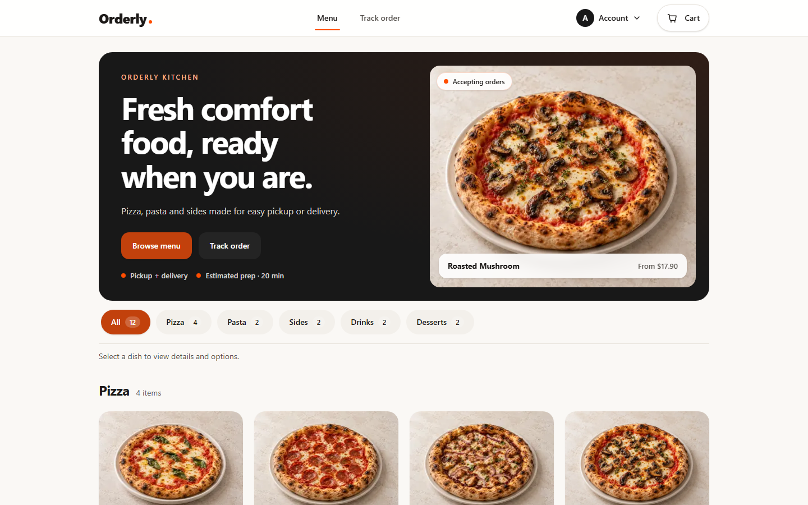
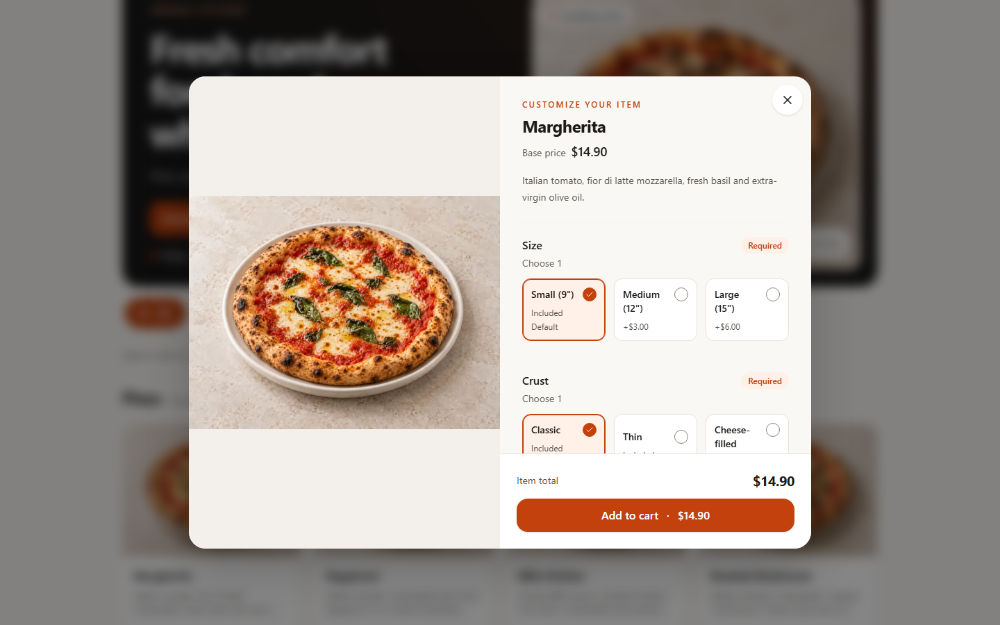
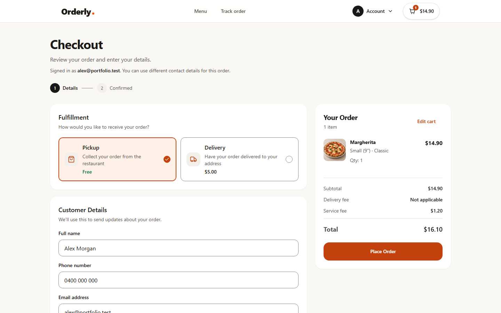
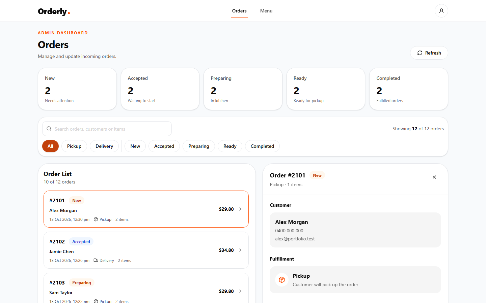
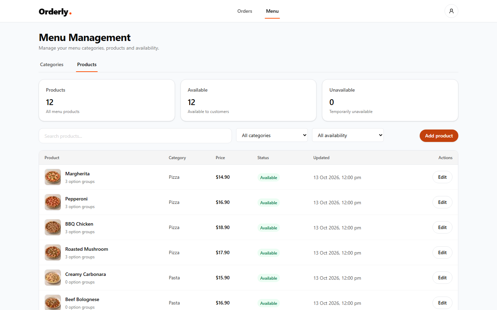
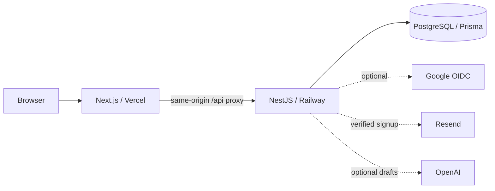

# Orderly

## Overview and Demo Links

Orderly is a full-stack food-ordering portfolio project built with **Next.js, React, NestJS, PostgreSQL and TypeScript**. It combines a customer storefront with a separately authenticated Admin workspace, with particular attention to checkout integrity, private order ownership and session security.

[Live Customer demo](https://orderly-web-gamma.vercel.app) · [Admin walkthrough (75-second MP4)](docs/portfolio/assets/admin-walkthrough.mp4) · [API health](https://orderly-production-1ac4.up.railway.app/api/health)

The Customer root and API health returned HTTP 200 during the **13 October 2026 Stage 17 check**. This verifies reachability only; the deployed revision, registration mode and complete workflows were not verified. Admin is presented through local synthetic screenshots and a recording; V1 has no public Admin credentials or interactive Admin demo.

## Product Showcase

### Customer storefront



### Product configuration and checkout

| Configure an item                                                                   | Review and place an order                                                                       |
| ----------------------------------------------------------------------------------- | ----------------------------------------------------------------------------------------------- |
|  |  |

### Admin orders



### Admin catalog



[Full screenshot gallery](docs/portfolio/screenshots.md): [menu](docs/portfolio/assets/customer-menu.png), [cart](docs/portfolio/assets/customer-cart.png), [account](docs/portfolio/assets/customer-account.png), [order history](docs/portfolio/assets/customer-history.png), and [categories](docs/portfolio/assets/admin-categories.png).

All media uses the local optimized build at 1440×900 with synthetic data. The account shown deliberately has unverified email ownership. The walkthrough performs real UI operations and explicitly labels protected API-only product lifecycle operations; captions are editorial overlays.

## Key Features

| Area                  | Implemented scope                                                                                                                                                                                                                            |
| --------------------- | -------------------------------------------------------------------------------------------------------------------------------------------------------------------------------------------------------------------------------------------- |
| Customer ordering     | API-driven menu; sizes, modifiers and add-ons; persistent cart; guest or signed-in pickup/delivery checkout; receipt-code guest tracking                                                                                                     |
| Customer accounts     | Email/password and Google OIDC sign-in; explicit Google linking; profile/password management; private order history with URL-backed filters, sorting and pagination; reauthenticated account deletion with active-order checks               |
| Admin UI              | Order counts, search, status/fulfillment filters, pagination, detail and validated transitions; category create/edit, availability, archive/restore and drag reorder; product create/edit, nested option groups and catalog search/filtering |
| Admin API-only        | Product availability changes and archive are implemented in protected endpoints, but lack frontend mutation controls                                                                                                                         |
| Optional AI assistant | Structured description suggestions become reviewable drafts; applying a suggestion still requires a normal product save                                                                                                                      |

Registration is an explicit API configuration choice: `verified` (default) completes signup after mailbox proof; `direct` creates an account immediately with **unverified** email. Direct and historical accounts are not silently marked verified. Matching contact email never claims existing orders or automatically merges accounts. Provider-backed features are implemented and synthetically tested; real-provider acceptance remains conditional below.

## Tech Stack

| Layer                    | Technologies                                                                                                             |
| ------------------------ | ------------------------------------------------------------------------------------------------------------------------ |
| Frontend                 | Next.js 16, React 19, TypeScript, Tailwind CSS, Redux Toolkit, TanStack Query, React Hook Form, dnd-kit                  |
| API and data             | NestJS 11, Prisma 6, PostgreSQL, bcrypt, JWT access/refresh sessions in HttpOnly cookies                                 |
| Testing and tooling      | Jest, React Testing Library, Supertest, Playwright, pnpm, Docker, GitHub Actions                                         |
| Hosting and integrations | Vercel frontend/proxy, Railway API, PostgreSQL/Neon configuration; optional Google OIDC, Resend and OpenAI Responses API |

## Engineering Highlights

Customer and Admin use separate identities, session tables, JWT keys, cookies and guards. The following decisions are implemented in source; deployed acceptance is tracked separately.

- **Atomic order numbers.** PostgreSQL `nextval` allocates customer-visible numbers, avoiding a “read latest, add one” race across concurrent checkouts and API instances. Failed transactions can leave sequence gaps; numbers are unique, not gapless.
- **Server-authoritative pricing.** The client sends product IDs, quantities and option selections. The API reloads the catalog, validates availability/selection rules and calculates item prices, fees and totals in cents before persistence; submitted client totals are not authoritative.
- **Ownership and IDOR prevention.** Checkout derives `customerUserId` from the validated session, never the request body or contact email. History detail reads query `{ id, customerUserId }` together, returning the same 404 for missing, guest or another customer's orders. Guest access uses a time-limited receipt capability.
- **Refresh rotation and revocation.** Database-backed sessions store refresh digests and versions. Conditional compare-and-swap updates let one refresh rotate the credential; replay detection revokes the affected session. Logout, password change and deletion revoke access through live session checks, with an absolute lifetime cap for Customer sessions.
- **Google identity and safe linking.** OIDC validates the provider subject (`sub`) using authorization code flow, PKCE, state and nonce. Email equality cannot merge accounts. Explicit linking requires the initiating live session, current-password proof and verified matching provider email; the final association is transactionally coordinated with revocation.
- **Signed proxy identity.** The Next.js proxy removes caller-supplied Orderly identity headers, normalizes the forwarded client IP and signs it with HMAC. The API verifies that signature before using the identity for throttling; invalid/absent proof falls back to the transport peer, not arbitrary forwarding headers. HTTP rate counters remain process-local.
- **Frontend state ownership.** Redux holds the persistent cart and Customer auth state; TanStack Query owns menu, Admin and private order data; React Hook Form owns form state. Customer-private queries are removed on identity change/session expiry while public menu data is preserved.
- **Transaction-safe checkout and history.** Catalog validation, server-calculated totals and order/item/option snapshots are persisted in one Prisma transaction. Owned checkout participates in the same advisory-lock coordination as account deletion, preventing an order from attaching to a deleted identity. Expired authenticated checkout requires an explicit guest choice; it is not silently downgraded. Later catalog edits do not rewrite historical item selections or prices.

Details and contracts: [architecture/API overview](docs/portfolio/architecture-api.md), [customer authentication](docs/customer-auth.md), and [current security acceptance findings](docs/v1-final-customer-security-acceptance-report.md).

## Architecture



Production browser requests use same-origin `/api` routing, keeping cookie authentication on the web origin while the API remains a separate service. Optional providers are called server-side. Hosting labels describe the deployment design; console settings and exact deployed revisions still require operator verification.

The database models categories/products/options, orders with stored item/price snapshots, and separate Customer/Admin session lifecycles. API money uses integer cents; catalog storage uses decimals. `CustomerUser` is the current customer identity; the schema also retains a legacy `User` model. The [Prisma schema](apps/api/prisma/schema.prisma) and [API controllers/DTOs](apps/api/src/modules) are authoritative.

## Testing & Quality Assurance

The [dual-registration acceptance report](docs/v1-dual-registration-mode-report.md) records these **prior scoped local results**, not a fresh run for this README edit:

| Layer                    | Recorded passing evidence                                                                       |
| ------------------------ | ----------------------------------------------------------------------------------------------- |
| API unit                 | 164 tests across 16 suites                                                                      |
| PostgreSQL integration   | 188 tests across 14 suites, with real migrations and guarded local fixtures                     |
| Frontend components      | 342 tests across 47 suites                                                                      |
| Optimized-build Chromium | 45 selected cases: 3 direct-registration, 37 Security 2B and 5 presentation cases; zero retries |
| Static/build checks      | API/web lint, application/test typechecking and builds passed                                   |

Coverage includes pricing and transactional rollback, order-number concurrency, ownership isolation, refresh/revocation, verification/deletion, OAuth/linking and Customer/Admin workflows. Mocked email/OIDC fixtures validate application behavior, not live provider acceptance or all-browser compatibility. Earlier failed attempts remain documented.

[Stage 17 media validation](docs/portfolio/review-report.md) separately records one complete passing capture workflow, 10 consistent screenshots and a decoded 74.96-second MP4. [GitHub Actions](.github/workflows/ci.yml) is configured to run quality checks and builds; it contains no deployment job.

## Local Development

Requirements: **Node.js 22.12+**, **pnpm 10.14.0**, and Docker/PostgreSQL 16. From the repository root:

```sh
pnpm install --frozen-lockfile
pnpm db:generate
pnpm db:up
```

Copy [API environment example](apps/api/.env.example) to `apps/api/.env` and [web environment example](apps/web/.env.example) to `apps/web/.env.local`. Generate four independent JWT secrets and set private local Admin seed credentials. Verified signup requires configured email delivery; choose `CUSTOMER_REGISTRATION_MODE=direct` explicitly for local immediate signup with unverified email.

```sh
pnpm db:migrate
pnpm --filter api seed:demo
pnpm --filter api seed:admin
```

The catalog seed requires an empty catalog. Start the services in **separate terminals**:

```sh
pnpm dev:api
```

```sh
pnpm dev:web
```

Open `http://localhost:3000`; the local API runs at `http://localhost:4000/api`. For browser tests, install Chromium once:

```sh
pnpm --filter web exec playwright install chromium
```

Run checks from the root:

```sh
pnpm test:api:unit --runInBand
pnpm test:api:e2e
pnpm test:web --runInBand
pnpm test:browser
pnpm test:quality
```

Local development uses `orderly_db`; database/browser runners reset only the guarded loopback `orderly_test?schema=public` target. Run database suites sequentially and never point reset/seed test workflows at a deployed database. See the [media workflow](scripts/portfolio/README.md) for reproducing the showcase.

## Deployment & Verification Status

| Evidence boundary | Status                                                                                                                         |
| ----------------- | ------------------------------------------------------------------------------------------------------------------------------ |
| Implemented       | Features and engineering decisions above are present in current source; UI/API-only distinctions are explicit                  |
| Locally tested    | Scoped acceptance and synthetic optimized-build media evidence are linked above                                                |
| Publicly verified | Customer root and API health reachability only, checked during Stage 17 on 13 October 2026                                     |
| Not established   | Current deployed revision/mode, full public workflows, real-provider acceptance and remaining operational/cross-engine staging |

Read the [environment, Railway/Vercel and migration guide](docs/portfolio/release-guide.md) before release. API startup does **not** apply migrations; an explicit `prisma migrate deploy` step must precede activation of the matching API. Deployed databases must never use `migrate reset` or destructive test fixtures. Secrets stay server-side, outside `NEXT_PUBLIC_*` variables.

Outstanding release conditions include real Resend domain/inbox/link behavior, Google fresh-auth deletion behavior, recoverable backup/restore and populated migration/cutover, coordinated rollout, deployed secret redaction, and focused Firefox/Safari/mobile assistive-technology checks. Direct signup lacks mailbox proof; HTTP throttling is process-local and expired security metadata is cleaned lazily. Deletion retains business snapshots and does not promise erasure of backups/provider/browser copies. Security 2A/2B protections remain required in either registration mode.

The [packaging review](docs/portfolio/review-report.md) also records a blank category-list Order column in the captured UI, despite verified persisted reordering. No online payment integration, analytics dashboard or Admin settings interface is claimed.

## Documentation & Roadmap

- [Architecture, database and API](docs/portfolio/architecture-api.md)
- [Customer authentication](docs/customer-auth.md), [Security 2A: email verification](docs/v1-registration-email-verification-report.md), [Security 2B: account deletion](docs/v1-customer-account-deletion-report.md)
- [Guest receipt security](docs/v1-guest-tracking-security-hardening-report.md) and [final security acceptance](docs/v1-final-customer-security-acceptance-report.md)
- [Registration modes and test evidence](docs/v1-dual-registration-mode-report.md)
- [Release/environment guide](docs/portfolio/release-guide.md), [packaging review](docs/portfolio/review-report.md), and [portfolio presentation summary](docs/portfolio/presentation-summary.md)
- [Screenshot gallery](docs/portfolio/screenshots.md) and [reproducible recording workflow](scripts/portfolio/README.md)

V1 uses a Customer demo plus recorded Admin presentation. A safely isolated interactive Admin demo is a possible **V1.1** enhancement; product lifecycle UI, category-column follow-up, operational cleanup/distributed throttling and remaining provider acceptance are separately scoped future work. They are not shipped or accepted enhancements.
