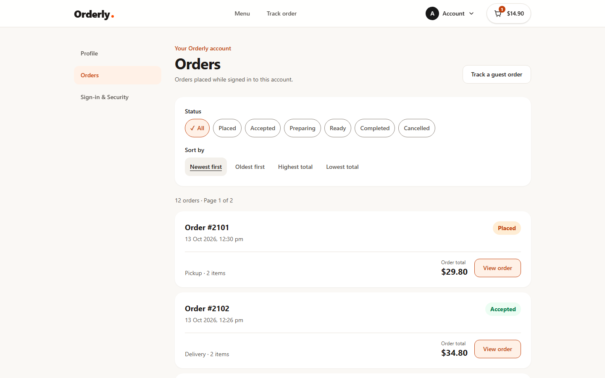
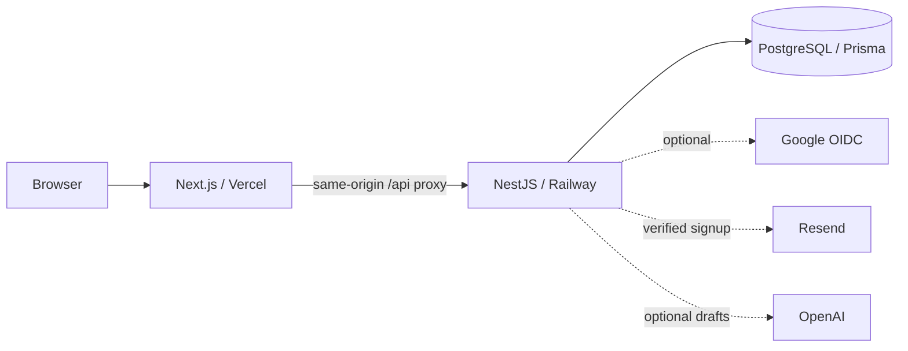

# Orderly

Orderly is a full-stack food-ordering portfolio project with a customer storefront and a separately authenticated Admin workspace. It demonstrates transaction-safe checkout, private order ownership, session lifecycle security, and practical catalog/order operations.

[Live Customer demo](https://orderly-web-gamma.vercel.app) · [Admin walkthrough (MP4)](docs/portfolio/assets/admin-walkthrough.mp4) · [Release guide](docs/portfolio/release-guide.md) · [Packaging review](docs/portfolio/review-report.md)

The Customer URL and [API health endpoint](https://orderly-production-1ac4.up.railway.app/api/health) returned HTTP 200 on **13 October 2026**. This is a reachability check, not proof that the current source or every workflow is deployed. Screenshots and the walkthrough below use the current local production build and synthetic data. There are no public Admin credentials or interactive Admin demo in V1.

## Selected screenshots

| Customer storefront | Product configuration |
| --- | --- |
|  |  |

| Checkout | Private order history |
| --- | --- |
|  |  |

| Admin orders | Admin catalog |
| --- | --- |
|  |  |

[Menu](docs/portfolio/assets/customer-menu.png), [cart](docs/portfolio/assets/customer-cart.png), [account](docs/portfolio/assets/customer-account.png), and [categories](docs/portfolio/assets/admin-categories.png) are also included. All displayed identities are synthetic; the account intentionally has no verified-email evidence.

## Implemented functionality

**Customer:** API-driven menu, size/modifier/add-on selections, persistent cart, pickup/delivery checkout, guest ordering, receipt-code tracking, customer login/registration, Google OIDC sign-in and explicit linking, profile/password management, private order history with URL-backed filters/sorting/pagination, and account deletion with reauthentication and active-order checks.

Registration is configurable: `verified` (default) completes signup after mailbox proof; `direct` creates an account immediately with **unverified** email. Direct and historical accounts are not silently upgraded to verified. No email-based order claiming or automatic account merging occurs.

**Admin UI:** order counts, search, status/fulfillment filters, detail and validated status transitions; category creation/editing, availability, archive/restore and reordering; product creation/editing with nested option groups and search/filtering. Product availability and archive are implemented in protected API endpoints but currently lack UI mutation controls. The video labels these API operations explicitly. Optional AI description suggestions are reviewed drafts, never direct database writes; external-provider behavior is not newly verified here.

## Stack and architecture

- Frontend: Next.js 16, React 19, TypeScript, Tailwind CSS, Redux Toolkit, TanStack Query, React Hook Form, dnd-kit.
- API/data: NestJS 11, Prisma 6, PostgreSQL; bcrypt, cookie-backed JWT access/refresh sessions.
- Quality: Jest, React Testing Library, Supertest, Playwright, GitHub Actions.
- Deployment design: Vercel frontend/proxy, Railway API, PostgreSQL (Neon configuration documented); optional Google OIDC, Resend and OpenAI integrations.



Redux holds client-owned cart/auth state; TanStack Query holds server state, with private customer cache cleared on identity changes. Forms use React Hook Form. Deployment console settings and exact deployed revisions require operator verification.

## Authentication, authorization and security

Customer/Admin identities, session tables, JWT keys, cookies and guards are separate. HttpOnly cookies, refresh rotation, digest-backed sessions, revocation and customer absolute expiry protect the authentication lifecycle. Mutations enforce the configured origin; production uses HTTPS and a signed proxy client identity for throttling.

The server derives order ownership from the validated customer session, reloads catalog prices, validates options and calculates totals. PostgreSQL allocates order numbers atomically. Customer history queries include owner UUID; unauthorized and missing records return the same 404. Guest tracking requires an order number and a time-limited receipt capability; contact details alone are insufficient.

Google uses authorization code/OIDC, PKCE, state and nonce. Provider subject is identity; matching email never merges accounts automatically. Verified registration uses expiring, single-use digest-backed links. Deletion requires password or fresh subject-bound Google proof, revokes sessions and scrubs retained terminal-order contact data. Business snapshots remain; deletion does not promise erasure of backups/provider/browser copies. See [Security 2A](docs/v1-registration-email-verification-report.md), [Security 2B](docs/v1-customer-account-deletion-report.md), and [final security acceptance](docs/v1-final-customer-security-acceptance-report.md).

## Database and API

Catalog tables model categories, products, option groups and options. Orders retain item/option/price snapshots independent of later catalog edits. Customer/Admin sessions and customer verification/OAuth/deletion records support lifecycle authorization. Money uses integer cents at API boundaries and decimal catalog storage. The schema also retains a legacy `User` model; current customer identity is `CustomerUser`.

[Database/API overview](docs/portfolio/architecture-api.md) maps routes to their authorization boundaries; [Prisma schema](apps/api/prisma/schema.prisma) and controller DTOs are authoritative. No generated OpenAPI specification is claimed.

## Testing and release evidence

The latest [dual-registration report](docs/v1-dual-registration-mode-report.md) records 164 API unit tests, 188 real-PostgreSQL integration tests, 342 frontend component tests, and 45 selected Chromium browser tests passing, plus lint/typecheck/build checks. These are historical scoped results, not a fresh full-suite run or an all-browser certification. Earlier failures remain in the reports. CI is configured to run quality checks and builds; it does not establish provider acceptance or prove an automatic deployment pipeline.

Stage 17 adds a reproducible Playwright media workflow with real application operations. See its [instructions](scripts/portfolio/README.md) and [review report](docs/portfolio/review-report.md) for this task's validation.

## Local development

Use Node.js **22.12+**, pnpm **10.14.0**, and Docker/PostgreSQL 16. From the repository root:

```sh
pnpm install --frozen-lockfile
pnpm db:generate
pnpm db:up
```

Copy `apps/api/.env.example` to `apps/api/.env` and `apps/web/.env.example` to `apps/web/.env.local`. Replace the four JWT placeholders with independent random secrets. Local PostgreSQL defaults target `orderly_db`; the destructive test runners require a separate loopback `orderly_test` database. Verified signup needs a working configured email provider; direct signup is an explicit unverified-email choice.

```sh
pnpm db:migrate
pnpm --filter api seed:demo
pnpm --filter api seed:admin
pnpm dev:api
pnpm dev:web
```

Run API and web in separate terminals. The catalog seed requires an empty catalog; configure private local Admin seed credentials first. No Admin credentials are published here.

```sh
pnpm test:api:unit --runInBand
pnpm test:api:e2e
pnpm test:web --runInBand
pnpm test:browser
pnpm test:quality
```

Database/browser runners reset only the guarded local test target; do not run overlapping database suites or point these commands at a deployed database.

## Deployment and limitations

Read the [environment, Railway/Vercel and migration guide](docs/portfolio/release-guide.md) before release. API startup does **not** apply migrations; configure an explicit `prisma migrate deploy` step. No deployment was performed for packaging.

Real Resend delivery/domain/link behavior, Google fresh-auth deletion behavior, backup restore and populated upgrade/cutover, deployed secret redaction, and focused Firefox/Safari/assistive-technology staging remain open release conditions. Direct registration deliberately lacks mailbox ownership proof. HTTP rate counters are process-local; expired security metadata is cleaned lazily. No online payment provider, analytics dashboard, or Admin settings UI is claimed.

V1 prioritizes a Customer demo plus recorded Admin presentation. A safely isolated interactive Admin demo may be considered for **V1.1**, alongside separately scoped product lifecycle UI, operational cleanup/rate-limit improvements and remaining provider acceptance. These are roadmap items, not shipped features.
